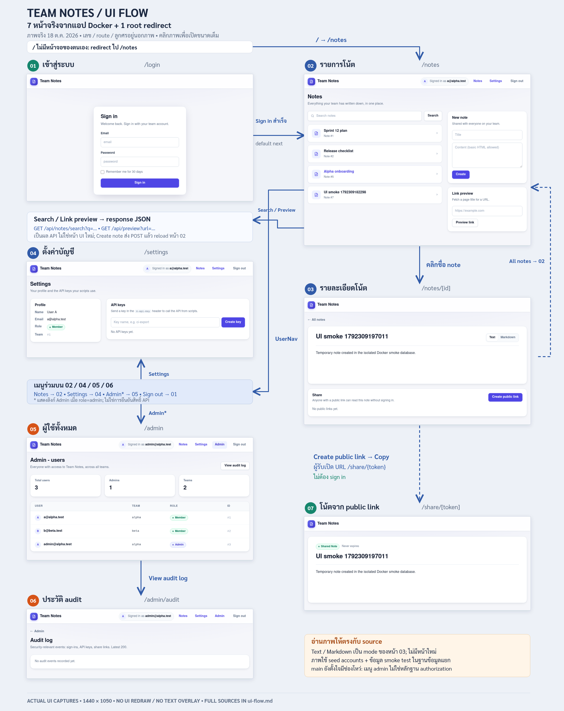

# Team Notes: UI Flow

แผนภาพนี้นับ **7 หน้าที่ render UI จริง** จาก 7 route patterns และแยก `/` ซึ่งทำ redirect อย่างเดียวออกต่างหาก รวมพบ `page.tsx` 8 ไฟล์ ภาพทุกหน้าเป็น screenshot จริงจาก Team Notes ที่รันผ่าน Docker ในฐานข้อมูลทดสอบแยก ส่วนลูกศรและคำอธิบายอ้างอิง navigation/form handlers ใน source ของ `main`

[เปิด SVG เพื่อขยายหรือกดภาพย่อย](./ui-flow.svg) · [เปิด PNG ขนาดเต็ม](./ui-flow.png)

ภาพหน้าจอไม่มีการวาด UI ทับหรือเปลี่ยนข้อความ เลขหน้า, route และลูกศรอยู่ภายนอกภาพ แต่ละภาพเป็นคนละจังหวะของ smoke run; รายการโน้ตจึงอาจต่างกันหลังสร้างโน้ตทดสอบ

## หมายเลขหน้า

| เลข | Route pattern | สิ่งที่อยู่บนหน้า | ที่มา |
| --- | --- | --- | --- |
| 01 | `/login` | Email, password, Remember me, Sign in และข้อความผิดพลาด | [login/page.tsx](../web/app/login/page.tsx) |
| 02 | `/notes` | รายการโน้ต, Search, New note และ Link preview | [notes/page.tsx](../web/app/notes/page.tsx), [NewNoteForm](../web/components/NewNoteForm.tsx) |
| 03 | `/notes/[id]` | รายละเอียดโน้ต, Text/Markdown, attachment และ Share | [notes/[id]/page.tsx](../web/app/notes/%5Bid%5D/page.tsx), [ShareCard](../web/components/ShareCard.tsx) |
| 04 | `/settings` | Profile แบบอ่านอย่างเดียว, สร้างและ revoke API key | [settings/page.tsx](../web/app/settings/page.tsx), [ApiKeysCard](../web/components/ApiKeysCard.tsx) |
| 05 | `/admin` | สถิติผู้ใช้และตาราง User/Team/Role/ID | [admin/page.tsx](../web/app/admin/page.tsx) |
| 06 | `/admin/audit` | ตาราง audit ล่าสุดไม่เกิน 200 รายการ หรือสถานะว่าง | [admin/audit/page.tsx](../web/app/admin/audit/page.tsx) |
| 07 | `/share/[token]` | โน้ตที่เปิดด้วย public link, expiry label และ Markdown HTML ไม่มี UserNav | [share/[token]/page.tsx](../web/app/share/%5Btoken%5D/page.tsx) |

เลข 03 ครอบคลุมทุก note ID และเลข 07 ครอบคลุมทุก token ไม่ได้นับแต่ละค่าที่เป็นข้อมูลเป็นหน้าใหม่ `/notes/[id]?view=markdown` เป็น mode ของหน้า 03 ส่วน Text เป็น mode ปริยาย `next` และ `error` เป็น query ของหน้า 01; inline form, loading/error state, built-in 404 และผล JSON ไม่ได้เพิ่มจำนวนหน้า

`/` ไม่มีหน้าจอของตนเอง: [app/page.tsx](../web/app/page.tsx) เรียก `redirect('/notes')` ส่วน [layout.tsx](../web/app/layout.tsx) ให้แถบ Team Notes ร่วมกัน ไม่ใช่อีกหน้า

## การนำทางและการส่งฟอร์ม

เส้นในภาพแสดงเส้นทางหลักและใช้กล่องเมนูร่วมเพื่อลดเส้นไขว้ ปุ่มและฟอร์มที่อยู่บนหน้าเดียวไม่ได้กลายเป็นอีกหน้าหนึ่ง

| เริ่มจาก | ผู้ใช้ทำอะไร | ผลตาม source |
| --- | --- | --- |
| `/` | เปิด root | Redirect ไป 02; ถ้า `/api/me` ตอบ 401 หน้า 02 จะส่งต่อไป 01 พร้อม `next=/notes` |
| 01 | Sign in | `POST /api/auth/login`; สำเร็จได้ session cookie และ HTTP 303 ไปค่าของ `next` (ปริยาย `/notes`) |
| 01 | ข้อมูลเข้าใช้ไม่ผ่าน | HTTP 303 กลับ `/login?error=1` แล้วแสดงข้อความผิดพลาดบนหน้าเดิม; handler ปัจจุบันไม่ได้คง `next` ใน URL ของ error |
| 02 | คลิกชื่อโน้ต | เปิด 03 ด้วย `/notes/{id}` |
| 03 | All notes | กลับ 02 |
| 03 | Text / Markdown | สลับ URL `/notes/{id}` กับ `/notes/{id}?view=markdown`; mode Markdown เรียก `POST /api/markdown/render` ทาง server แล้วแสดง HTML บนหน้าเดิม |
| 02 | Search | ฟอร์ม GET ไป `/api/notes/search?q=…` ซึ่งแสดง response JSON ใน browser ไม่ใช่หน้า Search UI แยก |
| 02 | Link preview | ฟอร์ม GET ไป `/api/preview?url=…` ซึ่งแสดง response JSON ไม่ใช่หน้า Preview UI แยก |
| 02 | Create ใน New note | client ส่ง `POST /api/notes` แล้วเรียก `window.location.reload()` อยู่หน้า 02; ไม่ได้ redirect ไป note ที่เพิ่งสร้าง |
| 03 | เปิด attachment (เมื่อมี) | ไป `/api/files?name=…` เพื่อดาวน์โหลดไฟล์ ไม่ใช่หน้ารายละเอียดไฟล์ |
| 03 | Create public link / Revoke all | client ส่ง POST / DELETE ไป `/api/notes/{id}/share` แล้ว refresh รายการ shares บนหน้าเดิม |
| 03 → 07 | Copy public link แล้วผู้รับเปิด URL | Copy เขียน URL ลง clipboard; ไม่มี `<Link>` ที่กดเปิด share โดยตรงใน ShareCard ผู้รับเปิด `/share/{token}` ได้โดยไม่ sign in |
| 04 | Create key / Revoke | client ส่ง POST `/api/me/api-keys` หรือ DELETE `/api/me/api-keys/{id}` แล้ว refresh card อยู่หน้าเดิม |
| 05 | View audit log | เปิด 06 |
| 06 | Admin | กลับ 05 |

[UserNav](../web/components/UserNav.tsx) ปรากฏบนหน้า **02, 04, 05 และ 06**: Notes ไป 02, Settings ไป 04 และแสดงลิงก์ Admin ไป 05 เฉพาะเมื่อ `me.role === 'admin'` ทุกหน้าที่มี UserNav มี Sign out ซึ่งส่ง `POST /api/auth/logout` แล้ว HTTP 303 ไป 01 หน้า 03 มีเพียง All notes และหน้า 07 ไม่มี UserNav

ฝั่ง browser เรียก `/api/*` บน origin เดียวกัน แล้ว [Next rewrites](../web/next.config.ts) ส่งต่อไป API; การเรียกจาก Server Component ใช้ [web/lib/api.ts](../web/lib/api.ts) เพื่อแนบ session cookie ไปกับ request

## Session, public และ admin: ขอบเขตที่ต้องอ่านให้ถูก

- หน้า 02/04 ตรวจ `/api/me` และหน้า 03 ตรวจ note API: เมื่อได้ 401 จะไป `/login?next=…` หน้า 03 เรียก built-in `notFound()` เมื่อ API ตอบ 404
- หน้า 05/06 ส่งต่อไป login เมื่อ API ตอบ 401 และกลับ `/notes` เมื่อ API ตอบ 403 กลุ่ม Admin ในภาพจึงหมายถึง **เมนูที่แสดงสำหรับ role admin** ไม่ใช่หลักฐานว่า API หรือ URL ถูกป้องกันครบ
- บน `main` ปัจจุบัน [ListUsersAsync](../api/Endpoints/AdminEndpoints.cs) ตรวจ session แต่ไม่ตรวจ role ดังนั้น member ที่เปิด `/admin` ตรงยังอ่านรายการได้ ส่วน audit API ตรวจ role และตอบ 403 สำหรับ member นี่เป็นพฤติกรรมฝึกเรื่อง BFLA ไม่ควรซ่อนด้วยการวาดว่า route admin ทั้งหมดปิดกั้น member แล้ว
- หน้า 07 ไม่เรียก login; เมื่อ public share API ไม่สำเร็จจะแสดง built-in 404 [ShareEndpoints](../api/Endpoints/ShareEndpoints.cs) บน `main` ยังไม่ตรวจ revoked/expiry ตอนอ่าน ดังนั้นปุ่ม Revoke หรือ expiry label ใน UI ไม่ใช่หลักฐานว่า link ใช้ไม่ได้แล้ว
- Remember me เป็น checkbox จริงในหน้า 01 แต่ [AuthEndpoints](../api/Endpoints/AuthEndpoints.cs) บน `main` ไม่อ่าน field นี้ จึงไม่อ้างว่ามี session 30 วันแล้ว และ `next` ยังถูกส่งต่อโดยไม่มี local-path validation
- ไม่มีหน้าสมัครสมาชิก, ลืมรหัสผ่าน, แก้ profile, แก้/ลบ note หรือจัดการ role ใน UI ชุดนี้ แม้ API บางการกระทำจะมีอยู่ อย่าเพิ่มหน้าหรือเส้นทางที่ source ไม่ได้สร้าง

## ที่มาของ screenshot และการตรวจภาพ

จับภาพวันที่ **18 ตุลาคม 2026** จาก Chromium ที่ viewport **1440 × 1050** บน `http://127.0.0.1:23000` ซึ่งเป็น Docker stack กับฐานข้อมูลทดสอบแยก ใช้ seed accounts และสร้างโน้ตชั่วคราวสำหรับ smoke test ไม่ใช่ข้อมูล production ไม่ได้จับ cookie, terminal หรือไฟล์ `.env` ภาพที่เก็บใน `ui-screenshots/` เป็นไฟล์ PNG ต้นฉบับโดยไม่แก้ pixel ดู route, viewport และ SHA-256 ได้ใน [screenshot manifest](./ui-screenshots/manifest.json)

| เลข | Screenshot เต็ม | สิ่งที่ตรวจใน browser |
| --- | --- | --- |
| 01 | [01-login.png](./ui-screenshots/01-login.png) | CSS โหลด, ฟอร์ม sign in ใช้งานจริง |
| 02 | [02-notes.png](./ui-screenshots/02-notes.png) | รายการโน้ต, สร้างโน้ตด้วย client form แล้ว reload พบรายการใหม่ |
| 03 | [03-note-detail.png](./ui-screenshots/03-note-detail.png) | เปิดรายละเอียด, สลับ Text/Markdown, สร้าง public link ผ่าน ShareCard |
| 04 | [04-settings.png](./ui-screenshots/04-settings.png) | Profile และ API keys card แสดงครบ; ไม่สร้าง key เพื่อทำภาพนี้ |
| 05 | [05-admin-users.png](./ui-screenshots/05-admin-users.png) | เข้าด้วย admin แล้วเปิดตารางผู้ใช้ผ่านลิงก์ Admin |
| 06 | [06-audit-log.png](./ui-screenshots/06-audit-log.png) | เปิดจาก View audit log; seed นี้ไม่มี audit events |
| 07 | [07-public-share.png](./ui-screenshots/07-public-share.png) | เปิด link ที่สร้างจากหน้า 03 ใน browser context ใหม่ที่ไม่ได้ login |

Browser smoke ยังตรวจ root redirect และ Sign out ด้วยฟอร์มจริง ไม่พบ page JavaScript error หรือ horizontal overflow ในเจ็ดหน้านี้ การทดสอบนี้ยืนยันเส้นทาง UI ที่ลองเท่านั้น ไม่ใช่ security test ทั้งระบบ

แผนภาพ **2500 × 3150** ฝัง PNG ต้นฉบับลง SVG โดยตัดเฉพาะพื้นที่ว่างริมภาพ (crop เริ่มที่ x=210, y=0, กว้าง 1020 px; ความสูงตามเนื้อหาของแต่ละหน้า) และย่อแบบรักษาสัดส่วน ไม่มีการแก้สีหรือข้อความของแอป เมื่อกดภาพใน SVG หรือชื่อไฟล์ในตารางจะเปิด screenshot เต็ม ภาพ PNG รวมเรนเดอร์จาก SVG เดียวกัน

การเชื่อมต่อยังตรวจจาก source ของ `main` (UI ณ commit `4f48219`; การแก้ Docker/README ที่ทำพร้อมกันไม่เปลี่ยนรายการ route นี้) จึงแยกได้ว่าปุ่มใดเป็น navigation, form submission, query mode หรือการอัปเดตบนหน้าเดิม
