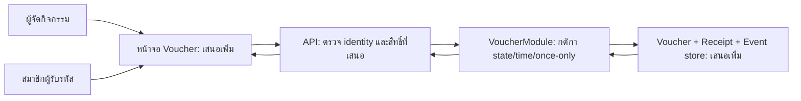

# ตัวอย่างผลลัพธ์: ออกแบบ Voucher สำหรับ Team Notes

> ตัวอย่างเอกสารออกแบบเพื่อการเรียนที่เรียบเรียงขึ้น ไม่ใช่ผลรัน AI รอบใหม่หรือหลักฐานว่า implement แล้ว ผู้เรียนเลือกทางอื่นได้เมื่อมีเหตุผลรองรับ

## 1. Requirement และขอบเขต

สมมติ Team Notes ต้องการเพิ่มคูปองรับสิทธิ์เข้าร่วมกิจกรรมภายในหนึ่งครั้ง แต่ละใบมีรหัสและเวลาหมดอายุ ผู้ถือรหัสใช้สิทธิ์ได้เมื่อเปิดใช้งานแล้ว การรับสิทธิ์สำเร็จแทนด้วย receipt และ business event หนึ่งรายการ ไม่มีการจ่ายเงินจริง

เอกสารนี้เสนอ architecture เท่านั้น ยังไม่มีหน้าจอ Voucher, HTTP endpoint หรือตาราง Voucher ใน Team Notes ให้ทดลอง รายละเอียดต้นทางคือ [VOUCHER_SCENARIO.md](../../workflow-security/VOUCHER_SCENARIO.md), [business contract](../../workflow-security/README.md#business-contract) และ [Voucher/VoucherModel.cs](../../workflow-security/Voucher/VoucherModel.cs)

**กติกาที่ต้องรักษา:** รับ `redeem` เฉพาะ `active` และ `now < expires_at` ต้อง activate ก่อนใช้ สำเร็จได้ไม่เกินหนึ่งครั้งและเพิ่ม redemption event ไม่เกินหนึ่งรายการต่อคูปอง แม้มีคำขอซ้ำหรือพร้อมกัน

รหัสไม่รู้จักหรือสถานะ `issued`, `cancelled`, `expired`, `used` ต้องถูกปฏิเสธโดยไม่สร้าง receipt/redemption/event ใหม่ ที่ `now == expires_at` ถือว่าหมดอายุ จะคง `active` หรือบันทึกเป็น `expired` ก็ได้ แต่ไม่เปลี่ยนเส้นตายเพื่อเปิดให้ใช้ต่อ การ retry หลังใช้สำเร็จต้องถูกปฏิเสธตาม contract นี้

## 2. สมมติฐานและ action inventory

สมมติให้ผู้จัดกิจกรรมสร้าง เปิดใช้ และยกเลิกคูปอง ส่วนสมาชิกที่ได้รับรหัสขอใช้สิทธิ์ บทบาทเหล่านี้เป็น **สิทธิ์ที่เสนอ** ไม่ใช่ authorization ที่ fixture บังคับแล้ว การผูกคูปองกับ user/team และสิทธิ์ admin ต้องสรุป permission matrix ก่อน implement ไม่อนุมานว่ารู้รหัสแล้วมีสิทธิ์ทุก action

| Action | ผู้เรียกที่เสนอ | ข้อมูลเข้า | เงื่อนไข/ข้อมูลที่ตรวจ | ผลที่ต้องการ |
| --- | --- | --- | --- | --- |
| `issue` | ผู้จัดกิจกรรม | `code`, `expires_at` | รหัสไม่ว่างและไม่ซ้ำ เส้นตายมีรูปแบบถูกต้อง | สร้าง `issued` ยังไม่มี receipt/event |
| `activate` | ผู้จัดกิจกรรม | `code` | พบคูปองและเป็น `issued` | เปลี่ยนเป็น `active` |
| `redeem` | สมาชิกที่ได้รับรหัส | `code`, actor ที่ตรวจแล้วในระบบเป้าหมาย | `active`, ยังไม่หมดอายุ และยังไม่มีผลสำเร็จ | เปลี่ยนเป็น `used`, บันทึกผู้ใช้สิทธิ์, receipt และ event หนึ่งรายการ |
| `cancel` | ผู้จัดกิจกรรม | `code` | พบคูปองและเป็น `issued` หรือ `active` | เปลี่ยนเป็น `cancelled` ใช้สิทธิ์ต่อไม่ได้ |

ข้อมูลของ fixture มี `code`, `expires_at`, `state`, `redeemed_by` ส่วน `redemption_count` คำนวณจาก events ไม่ใช่หลักฐานนับจากระบบชำระเงินจริง

## 3. Context/container ที่เสนอ

**Trust boundaries:** ผู้ใช้และ UI ส่งข้อมูลที่ยังไม่เชื่อถือ API เป้าหมายต้อง resolve actor จาก credentials ที่ตรวจแล้วและบังคับ permission matrix ก่อนส่งให้ VoucherModule ห้ามใช้ role หรือเวลาจาก request เป็นข้อเท็จจริงที่เชื่อถือทันที

VoucherModule เป็นเจ้าของ lifecycle และการตัดสิน once-only ส่วน storage adapter รับผิดชอบ transaction/constraint ตาม decision ด้านล่าง ทั้งสองส่วนเป็นข้อเสนอ ไม่ใช่คุณสมบัติที่วัดจาก fixture แล้ว

## 4. สอง quality scenarios และเกณฑ์ที่วางแผนตรวจ

| Scenario | สิ่งกระตุ้นและสภาพแวดล้อม | Response ที่ต้องการ | ตัววัดที่วางแผนใช้ |
| --- | --- | --- | --- |
| Q1: คำขอพร้อมกัน | คูปอง `active` ยังไม่หมดอายุ มีสองคำขอที่ผ่านสิทธิ์และชนกันก่อน commit | หนึ่งคำขอสำเร็จ อีกคำขอถูกปฏิเสธ | สำเร็จ 1, ถูกปฏิเสธ 1, state=`used`, receipt 1, redemption event 1 ไม่ว่าผู้เรียกคนใดชนะ |
| Q2: ล้มเหลวระหว่างบันทึก | หยุดการทำงานระหว่างเปลี่ยน state กับเขียน receipt/event แล้ว retry | ไม่ค้างครึ่งธุรกรรม และไม่สร้างผลซ้ำ | ถ้า rollback: state เดิม, receipt/event 0; ถ้า commit แล้ว: state=`used`, receipt/event 1 และ retry ไม่เพิ่มผล |

ตัวเลขในตารางเป็น **acceptance criteria ที่วางแผนไว้** ไม่ใช่ผลทดสอบหรือ benchmark ที่รันแล้ว Q2 ต้องตรวจเพิ่มกับ storage/transaction จริง เพราะ fixture ในหน่วยความจำไม่พิสูจน์ durability หรือ recovery หลัง process ล่ม

## 5. ADR-VOUCHER-0001

- **Status:** Proposed
- **Decision:** เสนอ modular monolith ภายใน API เดิม โดยแยก VoucherModule และ storage adapter ชัดเจน
- **Drivers:** รักษา once-only ได้ในขอบเขต transaction เดียว ลดจุดล้มเหลวข้าม service และให้ทีมทบทวนกติกาก่อนเพิ่ม deployment

### Options considered

| ทางเลือก | ประโยชน์ | ต้นทุน/ข้อจำกัด |
| --- | --- | --- |
| A: Modular monolith + transaction ใน storage เดียว | รวมการตรวจและเปลี่ยน state/receipt/event ใน commit เดียว ใช้ operation และ deployment เดิม | ต้องรักษา module boundary และจัดการการแข่งขันในฐานข้อมูล ขยาย service นี้แยกอิสระไม่ได้ทันที |
| B: Voucher service แยก | แยก ownership และ deployment ได้ชัด เหมาะเมื่อโหลดหรือทีมดูแลแยกจริง | เพิ่ม network failure, retry, observability และการประสานข้อมูลข้าม service โดยยังต้องแก้ once-only ภายใน service |

### Decision และเหตุผล

เลือก A เป็นข้อเสนอเริ่มต้น เพราะ scope ปัจจุบันเน้นกติกาหนึ่ง feature และยังไม่มีหลักฐานว่าต้อง scale/deploy แยก ให้ VoucherModule ตรวจ state/time และเขียน `used` พร้อม receipt/event ภายใน transaction เดียว พร้อม uniqueness ของผล redemption ต่อ voucher เป็นแนวทางที่ต้องออกแบบและพิสูจน์ตอน implement

ไม่เลือก B ในรอบนี้เพราะเพิ่ม failure modes ที่ไม่ได้ช่วยตอบ requirement เพิ่มในตอนนี้ ไม่ใช้คำว่า event-driven หรือ BFF เป็นคู่ตรงข้าม monolith โดยอัตโนมัติ เพราะเป็นการตัดสินใจคนละมิติ

### Consequences และข้อจำกัด

- ลดขอบเขตการประสาน commit แต่เพิ่มภาระด้าน transaction, constraints และการรักษา module boundary
- ต้องทบทวน permission matrix, การแจก/โอนรหัส และแหล่งเวลาที่เชื่อถือได้ก่อน implement
- หนึ่ง event ใน transaction หมายถึงหนึ่ง logical event record ไม่รับรองว่า message ถูกส่งถึง consumer ครั้งเดียว หากเพิ่มการส่งภายนอกต้องออกแบบ delivery/retry และ consumer idempotency แยก
- การเปลี่ยน `active` เป็น `expired` เมื่อหมดอายุเป็น bookkeeping ที่ยอมรับได้ แต่ห้ามเกิด receipt/event ใหม่หรือขยาย `expires_at`

### Revisit conditions

ทบทวน decision เมื่อมีหลักฐานว่า Voucher ต้อง deploy หรือ scale แยกจาก API, มีทีมเจ้าของแยก, หรือมี integration ที่ต้องเปลี่ยน transaction boundary บันทึก trade-offs ใหม่ก่อนเปลี่ยนไปใช้ service แยก

## 6. แยกสิ่งที่เสนอจากสิ่งที่ fixture พิสูจน์ได้

`VoucherService` ปัจจุบันเป็น single-process in-memory fixture ที่จงใจมีช่องโหว่ ใช้ actor สตริงจำลองและนาฬิกา `now` ที่ทดสอบควบคุมได้ จุด `checkpoint` เป็น test seam ไม่ใช่ input ของผู้ใช้

สามารถนำ contract นี้ไปเทียบ state/count/event ในการทดลองต่อได้ แต่ผลของ fixture ไม่รับรอง HTTP, authentication, authorization, database transaction, durability หรือ distributed delivery ของ architecture ที่เสนอนี้ เอกสารนี้ไม่ได้แก้ source หรือรัน tests/scanner

## 7. Handoff

- **ไป DFD/STRIDE:** ใช้ action inventory และ container เดิม ตั้ง flow IDs/ขอบเขตความเชื่อถือ แล้วเลือก T1/T2 พร้อม preconditions, impact และ missing evidence
- **ไป Control Contract:** เชื่อม threats กับ state/time/replay/atomic controls, negative/positive predicates และสอง risk decisions ที่มี priority/owner/response/residual risk
- **ไป fixture:** ใช้ contract ฉบับที่คนตรวจแล้วเทียบ observation ในขั้นทดลอง เก็บ `result.md`/`result.html` ของ ADR แยกจากโฟลเดอร์ DFD และ controls เพื่อไม่เขียนทับต้นทาง

ตัวอย่างนี้ใช้ [ADR ของ Team Notes](../../../docs/adr/0001-api-enforced-team-isolation.md) เป็นแนวทางจัดเอกสารเท่านั้น ไม่ย้าย team-isolation policy มาเป็น voucher policy โดยอัตโนมัติ
